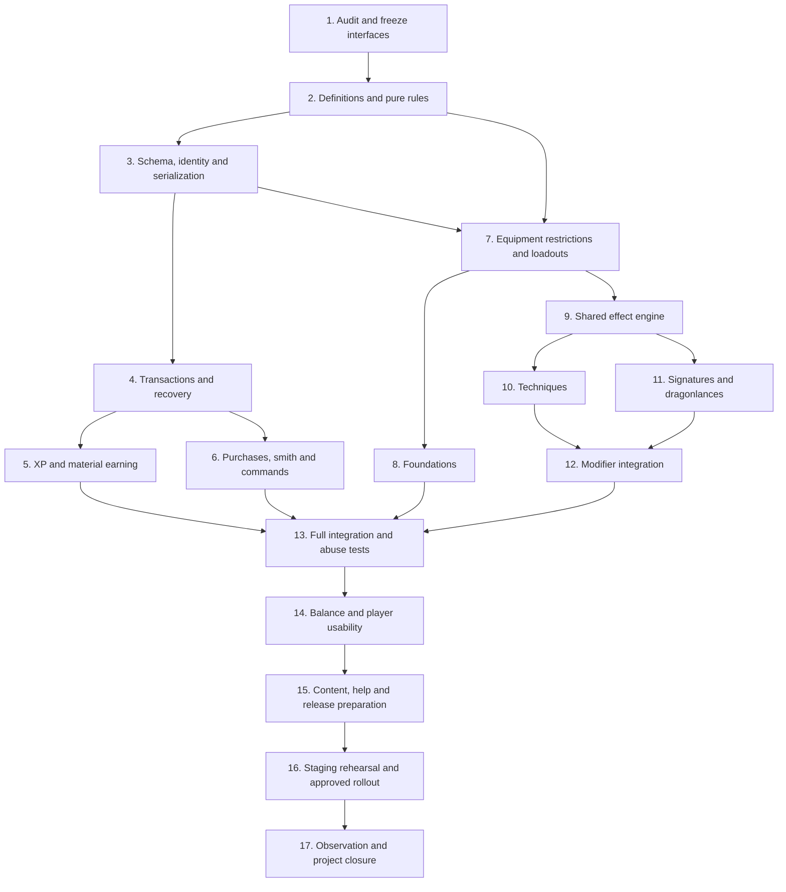

# Dragonmetal Awakening: implementation plan

Status: Phases 1–13 completed: audit, pure rules, schema/item identity, economic
transactions/recovery, personal earnings, smith commands, permanent ownership,
equipped loadouts/source lifetimes, all sixteen foundation gameplay bonuses,
the shared activation/effect engine, all eighteen live techniques, and all thirteen
signatures including registered dragonlance powers. Runtime services require
schema v5 plus durable local rolling-budget journals. Rank-IV/V integration
and the security/recovery regression suite are validated. Balance review and
live deployment remain later phases. See the
[Phase 1 audit](LEGENDARY_OBJECT_PHASE_1_AUDIT.md),
[Phase 2 rules](LEGENDARY_OBJECT_PHASE_2_RULES.md),
[Phase 3 persistence report](LEGENDARY_OBJECT_PHASE_3_PERSISTENCE.md),
[Phase 4 transaction report](LEGENDARY_OBJECT_PHASE_4_TRANSACTIONS.md),
[Phase 5 earnings report](LEGENDARY_OBJECT_PHASE_5_EARNINGS.md),
[Phase 6 command report](LEGENDARY_OBJECT_PHASE_6_COMMANDS.md),
[Phase 7 equipment report](LEGENDARY_OBJECT_PHASE_7_EQUIPMENT.md) and
[Phase 8 foundation report](LEGENDARY_OBJECT_PHASE_8_FOUNDATIONS.md) and
[Phase 9 effect-engine report](LEGENDARY_OBJECT_PHASE_9_EFFECTS.md) and
[Phase 10 techniques report](LEGENDARY_OBJECT_PHASE_10_TECHNIQUES.md) and
[Phase 11 signatures report](LEGENDARY_OBJECT_PHASE_11_SIGNATURES.md) and
[Phase 12 rank integration report](LEGENDARY_OBJECT_PHASE_12_RANKS.md) and
[Phase 13 security/integration report](LEGENDARY_OBJECT_PHASE_13_SECURITY.md).
Prepared: 2026-10-23.

Authoritative design: [full proposal](LEGENDARY_OBJECT_SYSTEM_PROPOSAL.md).
Player experience: [player guide](../guides/DRAGONMETAL_AWAKENING_PLAYER_GUIDE.md).

Implement the complete agreed design, including all 47 catalog entries. Milestones
below are integration gates, not permission to silently omit difficult powers.
No automatic source changes, database migrations, live world edits or restart are
authorized by creation of this plan.

## 1. Completion criteria

The project is complete when:

- All requested slots support the five ranks, exact costs and valid choices.
- A two-handed weapon's two independently paid channels match a comparable
  one-handed weapon plus off-hand item at every rank combination.
- Awakenings remain permanently on the original bound object instance.
- Normal eligible level-30 XP, gold payments, personal materials and daily caps
  work without duplication, lost payments or level loss.
- All 16 foundations, 18 techniques, 13 signatures, 12 paths and three modifiers
  behave as documented, including caps and cooldowns across the entire outfit.
- Players can complete the workflow at the smith and understand inactive choices.
- Save/load, storage, equipment changes and other economic systems preserve all
  invariants. Crash recovery and rollback procedures have been exercised.
- Numerical balance gates pass on representative builds, documentation matches
  implemented behavior, and the approved production content registry is installed.

## 2. Design invariants to encode first

| Area | Required invariant |
| --- | --- |
| Eligibility | Level-30 owner; eligible permanent level-20–30 equipment; normal equipment restrictions preserved. |
| Ownership | Unique physical item identity; permanent character binding; no transfer, extraction or investment refund. |
| Costs | Per-channel incremental rank table, exact XP/gold/material debits, no free supporting-channel advancement. |
| Personal balances | Character ID, not account or character name; no historical XP conversion. |
| Daily materials | 100 fragments, 20 total essences, one catalyst per UTC day; spending never restores allowance. |
| Passive power | 12 points, saved priorities and per-category caps across all equipment. |
| Major power | Three selected techniques/signatures across all equipment; no automatic replacement while unequipped. |
| Effect safety | Shared cooldowns, rolling budgets, no recursion, no effect replay and no reset through relogging or gear changes. |
| Persistence | One committed purchase/reward per unique operation; recover before the character can mutate affected state. |
| Content | Native `MOB_LEGENDARY_BOSS` flag and explicit true-dragonlance registry; never infer eligibility from names or level alone. |

Use these invariants as assertions and integration-test expectations, rather
than duplicating them as unrelated checks in every handler.

## 3. Sequence and dependencies

## 4. Phase 1 — repository audit and interface decisions

**Completed 2026-10-23.** Deliverable: [repository audit and interface contracts](LEGENDARY_OBJECT_PHASE_1_AUDIT.md).

**Work**

- Read applicable repository instructions and capture the baseline revision,
  existing dirty files and current warning/test status before coding.
- Trace `gain_exp()` in `limits.c`, quest completion in `quest.c`, kill/group
  credit in `fight.c`, and every relevant source of positive XP. Identify the
  exact point after modifiers/caps and before maximum-level suppression.
- Trace equipment/grip state in `act.item.c`, low-level equip/unequip helpers,
  attack/damage/saves/skills, spell expenditure and concentration failure.
- Trace ordinary player save/load and carried gold in `players.c`; gold is
  included in serialized character state. Review existing receipt/journal
  handling in `estate.c` before selecting the payment integration.
- Inventory every saved-object format and location: player inventory, houses,
  housing chests, corpse recovery, auction storage, mail/delivery and any other
  escrow. Identify codecs shared between these paths and gaps needing adapters.
- Find all give/drop/sell/auction/stall/craft/reforge/extract/clone routes. Record
  which move the same instance, replace an instance or change ownership.
- Check whether `infuse` or `invoke` is already registered or used in another
  subsystem. Preserve existing behavior with a compatible dispatch if necessary;
  do not repurpose a command silently.
- Map supported skills, fear/bleed/trip conditions, physical damage classification,
  dragon breath origin, actual dragon classification, formation state and real
  two-hand occupancy. Resolve these as named interfaces before power coding.
- Resolve existing ordinary binding versus dropping/corpse-looting behavior so
  the owner-storage/recovery exception does not become an ownership loophole.

**Deliverable:** a short implementation map of symbols/files, award provenance,
serializer coverage and confirmed command syntax. Record any conflict with the
proposal explicitly; update both design and player guide when behavior changes.

**Exit gate:** no unresolved ambiguity about gold recovery, item identity, hand
occupancy, power action recovery or supported condition semantics.

## 5. Phase 2 — definitions and pure rule helpers

**Completed 2026-10-23.** Deliverable: [catalog, rule helpers and validation](LEGENDARY_OBJECT_PHASE_2_RULES.md).

**Work**

- Introduce `legendary.c`/`legendary.h`, or split focused persistence/effect modules
  if warranted by size. Add sources to Make and CMake source lists as required.
- Define stable IDs for six essences, five ranks, paths, families, all catalog
  powers and modifiers. Never use display names as persistent identifiers.
- Build immutable tables for rank prices, reshape fees, per-category caps,
  cooldowns, slot menus and path additions directly from the proposal.
- Implement side-effect-free cost, eligibility, essence allocation, rank-V value,
  modifier compatibility, bonus cap and two-handed channel calculations.
- Use checked 64-bit arithmetic for costs and balances; reject overflow and
  negative input before narrowing to existing game types.
- Add definition validation: every slot has its promised menu, every ID resolves,
  every rank-IV selection has an eligible modifier, and no power is orphaned.

**Exit gate:** table and helper tests prove cumulative costs and parity for all
36 rank pairs (unawakened plus I–V on each side), including separate supporting
families. A single completed channel totals 3,850,000 XP, 775,000 gold, 700
fragments, 140 essences and six catalysts.

## 6. Phase 3 — schema, object identity and compatibility

**Completed.** Deliverable: [schema, codecs, identity lifecycle and database integration tests](LEGENDARY_OBJECT_PHASE_3_PERSISTENCE.md).

**Work**

- Add a versioned, idempotent migration for the proposed character, item, channel,
  cooldown, boss-claim, quest-XP-claim and operation records. Add indexed lookups,
  uniqueness constraints and schema-version checks.
- Store true-dragonlance records as versioned configuration. Boss eligibility is
  the native `MOB_LEGENDARY_BOSS` prototype flag; retain ordinary MEDIT review
  and world-file controls rather than a duplicate database registry.
- Add optional legendary object UUID serialization in every codec identified in
  phase 1. Do not assign shared UUIDs to prototypes or duplicate them on cloning.
- Load old items without legendary tags exactly as before. Allocate a UUID for
  the physical instance on first awakening, with a unique database constraint.
- Implement owner and channel load/save, copy/extraction lifecycle cleanup,
  missing-record handling, duplicate-UUID quarantine and deletion tombstones.
- Add persisted rolling budget entries and per-character cooldown state, either
  in dedicated auxiliary records or a documented bounded schema field. Include
  all such storage in the migration, not an undocumented later dependency.

**Exit gate:** round-trip fixtures for every saved-object location, older files
and records, duplicate identities, missing records and two-channel weapons pass.
An unsupported save path blocks release rather than silently discarding data.

## 7. Phase 4 — economic operations and crash recovery

**Completed:** backend, durable receipts/locks, login recovery and deterministic
fault regression tests. [Implementation and validation](LEGENDARY_OBJECT_PHASE_4_TRANSACTIONS.md).

**Work**

- Build one serialized per-character operation path for purchases, reshapes,
  exchanges and grants. Lock or version-check authoritative rows consistently.
- Generate unique quote/operation IDs, validate expiry and bind the quote to item
  identity, channel/rank, exact deductions and character/configuration versions.
- Implement the proposal's persistent payment journal and ordinary-gold checkpoint.
  Reuse proven estate receipt facilities where they satisfy the contract; extend
  them narrowly where they do not. Do not create two unrelated journals that can
  both debit the same purchase.
- Coordinate database progression changes with serialized player gold/object
  saves. Lock affected economic actions until reconciliation completes.
- Reconcile committed unapplied operations before login commands, item access or
  other spending. Make replays idempotent; uncommitted operations debit nothing.
- Fail closed on persistence errors with a useful player message and operation ID.
  Do not announce success before durable completion.

**Exit gate:** deterministic fault injection before/after each write, commit,
checkpoint and acknowledgment gives exactly one complete outcome. Repeated
confirmations, stale quotes and concurrent mutations cannot double-charge or
create free progression. This gate precedes enabling any real purchase.

## 8. Phase 5 — XP, participation and personal materials

**Completed:** explicit XP sources, durable award receipts, participation hooks,
capped material grants, UTC allowances, prototype cooldowns, exchange backend and
recovery/regression tests. [Implementation and validation](LEGENDARY_OBJECT_PHASE_5_EARNINGS.md).

**Work**

- Add explicit XP provenance through relevant award callers. Credit normal
  eligible level-30 awards once after final modifiers/caps, without changing
  ordinary XP/level behavior. Implement daily per-quest XP claims.
- Implement balances, acquisition counters, lazy UTC reset, overflow behavior,
  exchange rules and per-prototype rolling 20-hour boss cooldowns.
- Track qualifying damage/support actions against a stable encounter identity,
  at six-second separation; expire activity after 180 seconds.
- Resolve death participation, room/group/connection/alive requirements and
  recent 120-second activity before paying the configured deterministic rewards.
- Use unique boss-death claims and one centralized capped grant function for all
  sources. Reject summoned/charmed/player-owned and test encounters.
- Persist before reporting the received award; distinguish partial daily-cap
  awards from full awards and no reward.

**Exit gate:** tests cover healer/tank/pet-owner credit, stale tag attempts,
clone bosses, repeats, simultaneous kills, day boundaries, partial caps,
exchanges, overflowing balances and restart. Script/craft/reforge/admin XP is
excluded. One account's characters remain independent.

## 9. Phase 6 — smith, purchases and player commands

**Work**

- Implement `infuse` help, inspection, materials, paths, choices and loadout first.
- Add quote/confirm/cancel, awaken, advance, first choices, reshape and exchanges
  through the transaction service; no command mutates balances directly.
- Implement smith-presence verification and common out-of-combat checks. The
  service uses registered identity rather than an NPC name match.
- Show ownership permanence before first infusion and every exact cost before
  payment. Show remaining allowances and reset time with materials.
- Support explicit primary/supporting targeting and family choice. Make quote
  output state that the other channel will not advance.
- Present power names with stable IDs and valid subtype choices. List why an
  option is unavailable; do not leave the player to infer prerequisites.
- Preserve a free first selection across disconnects after rank purchase.
- Add priorities and attune/unattune commands without charging for rearranging
  already selected powers.

**Exit gate:** a scripted ordinary-character session can awaken, choose, upgrade,
reshape and exchange using only the proposed player-facing flow. Invalid input,
ambiguous object names, expired quotes and insufficient materials have clear
messages and no side effects.

## 10. Phase 7 — equipment rules, binding and loadout cache

**Work**

- Centralize immutable ownership/eligibility checks and apply them to every
  economic, transfer and transformation route from phase 1.
- Permit genuine owner storage and recovery while preserving UUIDs; reject
  transfers, market listings and object-replacing transformations before payment.
- Implement channel activation by actual wear slot and hand occupancy. Handle
  forced equipment removal, death, polymorph/disguise equipment and invalid gear.
- Calculate passive priorities/budget and three saved major selections. Expose
  active/dormant reasons through a single cached loadout interface.
- Invalidate/rebuild on equipment, grip, channel configuration and relevant
  character capability changes. Do not issue SQL queries per attack.
- Remove sourced ongoing effects immediately when their channel is invalidated;
  preserve cooldown and rolling-budget state.

**Exit gate:** full-outfit, sword/shield, dual-wield and two-handed tests preserve
capacity and costs. Grip changes cannot retain a fourth major power, duplicate
passives, preserve a ward illegally or reset any timer.

## 11. Phase 8 — foundations and existing calculations

**Work**

- Integrate F01–F16 into actual attack, damage, typed AC, save, ability, skill,
  maximum-pool, resistance, opposed-maneuver, movement and regeneration paths.
- Apply global passive points plus category/subtype ceilings, with explicitly
  allowed duplicate behavior only for Force, Vitality and Endurance.
- Use existing bonus types/caps correctly, and show superseded contributions.
- Prevent equip/reload from filling HP, movement or spell/psionic reserves.
- Keep resource-less characters and unsupported skills out of invalid selections.

**Exit gate:** all foundations work at their exact value and do not grow with
rank. Tests prove the +2 legendary flat-damage ceiling across nine channels and
no reserve-refill loop through equip/remove or reconnect.

## 12. Phase 9 — shared effect and activation engine

**Completed 2026-10-24.** Deliverable: [shared engine and validation report](LEGENDARY_OBJECT_PHASE_9_EFFECTS.md).

**Work**

- Add `infuse use` dispatch, legal-target checks, ability availability and action
  recovery. Enforce six-second shared activation plus individual/family cooldowns.
- Implement source-tagged prepared effects, delayed ticks, expiry and cancellation.
- Implement timestamped offensive, recipient-prevention, recipient-healing and
  resource rolling budgets, including save/restart behavior.
- Integrate at post-defense damage resolution and effective healing/resource
  payment, avoiding speculative accounting of effects that never happen.
- Encode redirection and bonus-damage origin flags to prevent recursive triggers,
  critical multipliers, repeated lifesteal effects or duplicate participation.
- Persist cooldown before effect application; never replay resolved combat
  effects after crash. Clean up all timers safely on character/object extraction.

**Exit gate:** synthetic effect fixtures establish exact timing, rounding,
source cancellation, cap consumption and family sharing before catalog powers
use this engine. No cooldown or rolling budget is restored by relogging.

## 13. Phase 10 — techniques

**Completed 2026-10-24.** Deliverable: [live techniques and validation report](LEGENDARY_OBJECT_PHASE_10_TECHNIQUES.md).

Implement all T01–T18 in groups, using the shared engine:

| Group | Powers | Integration focus |
| --- | --- | --- |
| Weapon/coordination | T01, T02, T03, T14 | Next attack, hit/miss consumption, real opposed checks and supported skill checks. |
| Defense/position | T05, T06, T07, T08, T17 | Post-defense physical/breath damage, safe redirect, trip and movement checks. |
| Healing/conditions | T09, T10, T11 | Effective healing, supported fear/bleed records, ordinary action restrictions. |
| Exploration/information | T04, T12, T13, T18 | Effective defenses, ordinary walking expenditure, adjacent legal exits and actual stealth checks. |
| Resource handling | T15, T16 | Paid eligible spells/powers, pre-effect concentration failure and shared savings allowance. |

**Exit gate:** each technique has exact base/V values, all eligible modifiers,
valid/invalid targets, expiry, cooldown and source-removal tests. Inspect text is
generated from the same definitions used by the mechanics.

## 14. Phase 11 — signatures and true dragonlances

Completed. See [implementation and validation](LEGENDARY_OBJECT_PHASE_11_SIGNATURES.md).

Implement all S01–S13:

| Group | Powers | Integration focus |
| --- | --- | --- |
| Protection/group | S01, S02, S04, S06, S08, S10 | Recipient ceilings, actual formation, typed saves/AC and single-packet breath protection. |
| Travel | S03 | Group membership, strongest movement reduction and documented room-change exception. |
| Healing/resource | S05, S07 | Delayed healing cancellation and actual resource savings, not theoretical credits. |
| Attack/support | S09, S13 | Designated target, miss consumption, ally validity and offensive/restorative limits. |
| Dragonlance | S11, S12 | Registered true lance, real dragon/mount identity, DC25 Fortitude, boss fallback and no scripted-phase interference. |

**Exit gate:** each signature passes base/V/modifier tests and cross-technique
family interactions. A renamed ordinary lance cannot access true-lance powers.
Both dragonlance channels still pay ordinary independent rank costs.

## 15. Phase 12 — rank-IV and rank-V integration

Completed. See [implementation and validation](LEGENDARY_OBJECT_PHASE_12_RANKS.md).

**Work**

- Apply Enduring, Ready and Distant aid through validated per-power capabilities.
  Keep S05 and S11 exceptions exactly as specified.
- Recompute modified cooldowns with ceiling rounding; leave family/global timers
  unchanged. Existing cooldown timestamps are not shortened by later reshaping.
- Ensure rank V changes only the documented values, without another property,
  higher passive contribution or extra major selection.
- Test changes of modifier target, path and supporting family, including invalid
  selections replaced without double reshape fees.

**Exit gate:** every legal power/modifier/rank combination resolves to one
validated definition; illegal combinations are rejected before payment.

## 16. Phase 13 — full integration, security and regression

Completed. See [implementation, measurements and operational requirements](LEGENDARY_OBJECT_PHASE_13_SECURITY.md).

**Work**

- Run the proposal's entire acceptance checklist against the real game codecs,
  database operations and combat pipeline, not only isolated mock handlers.
- Exercise character save/load, house/chest storage, corpse recovery, auction,
  stalls, mail/delivery, crafting/reforging, character deletion and object cloning.
- Add deterministic SQL-failure and process-interruption fixtures around durable
  operations and award claims. Verify recovery before normal commands resume.
- Fuzz numeric/object/channel/choice input boundaries and stale/duplicate IDs.
- Audit permission checks and SQL input handling; use bound/escaped structured
  data and stable numeric identities. Player commands cannot invoke staff grants.
- Compile with both supported build systems. Run meaningful existing regression
  suites and appropriate sanitizer checks on new lifecycle/event code.
- Measure per-round and login overhead. No attack-loop database access; clean
  event cancellation and bounded rolling histories are required.

**Exit gate:** no open duplication, ownership bypass, lost-payment, unbounded
stacking, save incompatibility or timer use-after-free defect.

## 17. Phase 14 — balance and usability review

Split into 14A and interim 14B to respect the owner's usage limit. Phase 14A
implements the approved economy/pricing and guided player flow. The owner
approved one-tenth gold costs and accepted the scripted usability walkthrough.
Native combat balance remains open in [interim phase 14B](LEGENDARY_OBJECT_PHASE_14B_HANDOFF.md). See the
[review pack and concrete pricing proposal](LEGENDARY_OBJECT_PHASE_14_REVIEW.md).

**Work**

- Run fixed-seed 10-minute and 30-second encounters on the seven representative
  build types required by the proposal. Test complete outfits and group stacking.
- Verify the proposed sustained-damage increase gate of at most 5% and incoming-
  damage reduction gate of at most 8% on each representative build.
- Measure XP/hour and gold/hour on three real endgame routes before approving
  the exact price table for release. Keep the agreed two-handed parity invariant
  through any pricing revision.
- Have an ordinary tester follow the player guide from no awakening to their
  first invoked power without developer explanations.
- Test whether menus explain paths, passive points, major selections, shared
  cooldowns and two channels. Record confusion rather than adding more jargon.
- Keep advanced information in inspection/reference views; first-use prompts
  should show the immediate next choice and cost.

**Exit gate:** balance targets pass and the owner reviews the actual player flow.
If a required rule changes, update implementation definitions, proposal and guide
in the same change. Do not silently substitute an easier design.

### Interim phase 14B — native combat validation (checkpointed; incomplete)

Resume from [the detailed handoff](LEGENDARY_OBJECT_PHASE_14B_HANDOFF.md).
The inconsistent display control was traced to consumption of Dark Revelation
while inspecting damage; the corrected native fixture now requires repeatable
controls. The owner also requested one additional rank-scaling passive per item,
alongside foundations. This layer is implemented and specified in
[Legendary item passives](LEGENDARY_ITEM_PASSIVES.md); SQL schema v6 is required.

Validate all seven builds and full
outfits, then run 30-second/600-second native encounters including real caster
rotations and group stacking. Close only after the 5%/8% gates pass. Pricing and
usability approvals are already recorded and must not be requested again.

## 18. Phase 15 — world configuration and release artifacts

Release preparation is now implemented, but it remains **disabled by default**
and must not be deployed until phase 14B closes. See the reviewed
[phase-15 release package](LEGENDARY_OBJECT_PHASE_15_RELEASE.md): it supplies
schema-v8 fail-closed feature gates, a verified existing smith and twelve
normally-reset boss candidates. Bosses are enabled by native MEDIT flag, not a
database registry. No live world or production database was changed.
No true-dragonlance object is currently verified, so lance-only powers remain
unavailable pending a separate content decision; ordinary lances are never
registered as substitutes.

**Work**

- Prepare a concrete smith prototype/service assignment in an existing forge,
  using selected available vnums; no new zone required.
- Prepare reviewed `MOB_LEGENDARY_BOSS` flag assignments and actual true-
  dragonlance records. Check reachability, normal availability and cooldown
  effects; eligible deaths roll essences and catalyst exchange remains available.
- Create in-game help covering the quick start, full choices, exact costs,
  daily reset and permanent investment. Synchronize the Markdown player guide.
- Prepare migration instructions, backup inventory, compatibility requirements,
  reconciliation diagnostics and runbook commands.
- Prepare separate feature switches for earning, purchases and major effects;
  include documented safe states and startup validation failures.
- Produce a reviewable release diff, migration and content/configuration files.
  Record any live world-file edits required; do not make them during preparation.

**Exit gate:** all release artifacts are ready for review, with no unidentified
production vnums, undocumented database changes or placeholder help locations.

## 19. Phase 16 — staging rehearsal and production rollout

The staging portion is implemented as the guarded
[Phase-16 rehearsal harness](LEGENDARY_OBJECT_PHASE_16_STAGING.md). It snapshots
an explicitly named sanitized staging database and optional save roots, applies
the migrations while all gates remain disabled, runs diagnostics and executes
the automated regression suite. It refuses a database name that is not clearly
staging. Production rollout remains an authorized operational action, not an
automated consequence of this implementation.

### Staging rehearsal

1. Use a sanitized production-like copy with legacy characters and stored items.
2. Back up character saves, object stores and affected database tables together.
3. Apply the migration and registries with earning/purchases/effects disabled.
4. Boot and verify old characters, unawakened items and existing economic systems.
5. Enable staff-only test access with nonproduction balances and registries.
6. Run the full player workflow, restart mid-operation and verify reconciliation.
7. Run balance/usability gates, then repeat migration and restore rehearsal.
8. Present the tested release and explicit production actions for approval.

### Approved production rollout

1. Announce maintenance and stop economic mutations cleanly.
2. Take a coherent backup, deploy the compatible binary, apply migration and
   approved configuration, then start with the system disabled.
3. Verify schema, legacy loads, smith service, registries and journal health.
4. Enable XP/material earning; inspect a small set of real reward events.
5. Enable purchases and effects after confirming correct state and help text.
6. Monitor commits, blocked grants, cooldowns and gameplay errors immediately.

These are future deployment steps. Execute them only under the authorization
applicable at implementation/release time, not merely because this plan exists.

### Recovery and rollback

- First disable purchases/earning or major effects as appropriate. Preserve all
  durable records, UUID tags and cooldowns; reconcile committed operations.
- Prefer a compatible corrective binary that can still read awakened objects.
  Do not boot an older serializer that strips UUIDs or legendary references.
- A full restore must restore character gold, saved objects and legendary tables
  to the same checkpoint. Never restore only one side of a purchase.
- Preserve an incident export and operation audit before restoring. Explain any
  unavoidable rollback of player activity; do not create informal item transfers
  or investment refunds as a substitute for recovery.

**Exit gate:** production is healthy, reconciled and running the approved data;
rollback has a tested coherent checkpoint and compatible binary.

## 20. Phase 17 — observation and closure

The observation implementation is the aggregate, read-only
[Phase-17 report and closure guide](LEGENDARY_OBJECT_PHASE_17_OBSERVATION.md).
It intentionally separates available durable metrics from performance questions
that require the Phase-14B native paired probes. It does not declare release or
closure complete.

For the first seven UTC days, review awards/caps, spending, purchase failures,
recovery operations, active loadouts, per-power contribution and player confusion
daily. Continue review after enough players reach III and V to exercise those
systems; seven days alone does not validate the final ranks.

Track:

- Award/XP rates and time spent reaching each rank.
- Material shortages by essence and catalyst source.
- Two-handed versus sword/shield investment and actual performance.
- Choice popularity, dormant reasons and reshape frequency.
- Shared-cooldown confusion and powers never invoked.
- Save/recovery failures, UUID quarantines and rejected ownership operations.

Correct defects without deleting progression. Version and publish balance
changes. Close the project only when all acceptance gates pass and unresolved
items are explicitly documented and accepted, rather than hidden behind feature
flags or described as complete.

## 21. Suggested reviewable change sequence

| Change | Scope | Must be independently verifiable |
| --- | --- | --- |
| 1 | Definitions, helpers and stable IDs | Exact tables, limits and parity tests. |
| 2 | Migration, UUID codecs and lifecycle | Backward compatibility and storage round trips. |
| 3 | Operations, gold checkpoint and reconciliation | Failure injection and exactly-once debits. |
| 4 | XP and boss/material ledgers | Provenance, participation, caps and duplicate claims. |
| 5 | Smith and `infuse` workflow | Complete economic/player command flow, effects still gated. |
| 6 | Binding, equipment and foundations | Full-outfit budget, grip safety and ordinary mechanics. |
| 7 | Effect engine and `infuse use` | Shared timers, rolling budgets, source cleanup. |
| 8 | All techniques | Catalog and integration fixtures. |
| 9 | Signatures, dragonlances and modifiers | Complete power coverage and rank upgrades. |
| 10 | Integration fixes, help and release artifacts | Whole-system tests, balance, usability and rehearsal. |

Do not enable a partially integrated system for players merely because an early
change compiles. Feature switches keep incomplete code inert until the end-to-end
state and recovery guarantees are ready.

## 22. Source starting points

- [limits.c](../../src/limits.c), [mudlim.h](../../src/mudlim.h), [quest.c](../../src/quest.c): XP awards and source classification.
- [players.c](../../src/players.c), [objsave.c](../../src/objsave.c), [estate.c](../../src/estate.c): character/object persistence and existing receipt infrastructure.
- [act.item.c](../../src/act.item.c), [fight.c](../../src/fight.c), [structs.h](../../src/structs.h): equipment, combat and wear slots.
- [interpreter.c](../../src/interpreter.c), [spec_procs.c](../../src/spec_procs.c): command/service registration.
- [player_shop.c](../../src/player_shop.c): player market ownership integration.

The phase-1 audit must locate the remaining exact hooks; these files are starting
points rather than a claim that every subsystem lives in one listed file.
